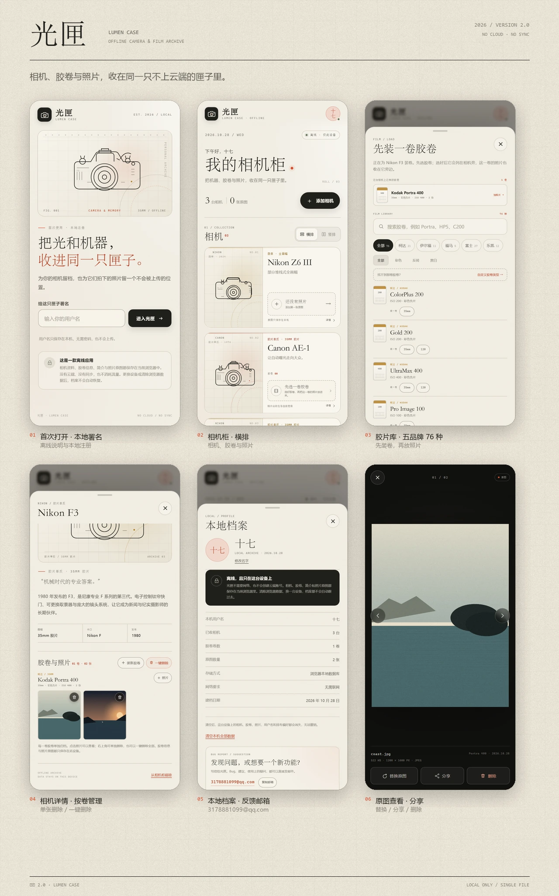
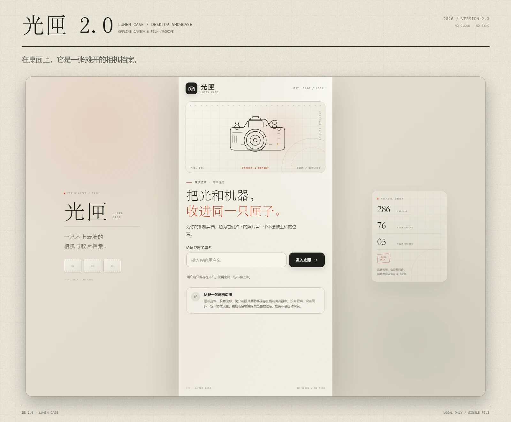

# 光匣 · Lumen Case

**离线相机与胶片档案 / An offline camera & film archive**

[在线使用 Live Demo](https://paronya208.github.io/lumen-case/) · [下载 Android APK](apk/lumen-case-2.0.apk) · [Android 源码](source/guangxia-android-source.zip)

---

## 中文

### 一只不上云端的相机匣

光匣把相机资料、胶卷和照片原图收进同一只本地档案。它不创建云端账号、不上传照片，也不需要联网。

- **286 台可换镜头相机**：尼康 94、佳能 98、索尼 67、哈苏 27，覆盖胶片单反、数码单反、微单与中画幅。
- **76 种胶卷**：柯达 21、伊尔福 11、福马 5、富士 27、乐凯 12；含已停产经典款，并支持自定义胶卷名字、毫米数和彩色 / 黑白。
- **胶片机按卷归档**：先选胶卷，再把这一卷的照片放进去；同一台相机可以并存多卷，每卷有自己的照片位。
- **原图管理**：相机详情页可单张删除照片，也可一键删除该相机全部照片；胶卷会保留为空卷。
- **查看与分享**：全屏查看原图，支持替换、分享和删除。Android 版通过系统分享面板分享原图。
- **排布与档案**：相机柜支持横排 / 竖排；本地档案页包含离线说明、存储统计和反馈邮箱。
- **完全本地**：相机、胶卷、照片和用户名都保存在当前设备，没有账号、云端或同步。

### 在线使用

打开 **https://paronya208.github.io/lumen-case/** 即可使用网页版。

首次打开需要联网加载页面；页面加载完成后，应用本身不发起任何网络请求。用户名、相机、胶卷和照片原图保存在浏览器的 `localStorage` / `IndexedDB` 中，清除浏览器数据或更换设备后不会自动恢复。

> 网页版和 Android APK 是两套独立的本地存储，数据不会在两者之间同步。

### Android 安装包

- 版本：**2.0**（versionCode 3）
- 文件：[apk/lumen-case-2.0.apk](apk/lumen-case-2.0.apk)
- 大小：约 113 KB
- 系统要求：Android 8.0 及以上（API 26）
- 权限：**无网络权限、无存储权限**
- SHA-256：`9FC65D2118BAD7335229868ED9755229FC4498914990DA534D8F2286EF0B6AC9`

APK 使用自签名证书。安装时按系统提示允许「安装未知来源应用」。如果已安装旧版，可直接覆盖安装；不要先卸载，否则本地相机会和照片会被清除。

### 数据与隐私

- 没有云端账号，不上传照片，不包含统计或广告 SDK。
- Android 版不申请 `INTERNET` 权限；网页版由 GitHub Pages 托管，但档案数据只存在浏览器本地。
- 分享和邮件是用户主动点击后交给系统应用处理，光匣本身不会上传文件。
- 卸载 APK、清除应用数据或清除浏览器数据，会永久删除对应的本地档案。

### 技术说明

- 网页版是单个 HTML 文件，原生 HTML / CSS / JavaScript，无框架、无外部资源。
- 数据存储：`localStorage` + IndexedDB v2；照片原图以 Blob 保存，缩略图由 Canvas 生成。
- Android 壳：原生 `Activity` + `WebView`，页面从 APK assets 读取，并通过固定同源地址保持本地存储稳定；分享使用轻量自定义 `ContentProvider`。
- Android 工程与构建说明见 [源码压缩包](source/guangxia-android-source.zip)。公开源码包不包含签名私钥；自行构建时请在本地配置自己的签名。

### 反馈

Bug、建议或使用问题：**3178881099@qq.com**

> 本项目为个人相机档案工具，与尼康、佳能、索尼、哈苏、柯达、伊尔福、福马、富士、乐凯等品牌无隶属关系；相关名称与商标归各自权利人所有。

桌面端展示 / Desktop view

 

---

## English

### About

Lumen Case is a fully offline camera and film archive. It keeps camera references, film rolls, and original photographs together on your own device — with no cloud account, no uploads, and no network dependency.

### Features

- **286 interchangeable-lens cameras** from Nikon, Canon, Sony, and Hasselblad: film SLRs, DSLRs, mirrorless, and medium format.
- **76 film stocks** from Kodak, Ilford, Foma, Fujifilm, and Lucky, including discontinued classics. You can also define a custom film with its name, format in millimetres, and colour / black-and-white type.
- **Film-roll based archiving**: choose a film roll first, then add that roll's photos. A camera can hold multiple rolls, each with its own photo strip.
- **Direct photo management** in camera details: delete one photo, or delete all photos for that camera in one action. Film rolls remain as empty rolls.
- **Viewer actions**: view the original, replace it, share it, or delete it. The Android build shares originals through the system share sheet.
- **Horizontal / vertical layouts**, plus a local profile with storage statistics and a feedback address.
- **Local-only by design**: cameras, rolls, photos, and the username stay on the current device. No account, no cloud, no sync.

### Live demo

Open **https://paronya208.github.io/lumen-case/**.

The first page load needs a network connection; after that, the app itself makes no network requests. Data is stored in the browser's `localStorage` / `IndexedDB`. Clearing browser data or switching devices will not carry the archive over.

> The web demo and the Android APK use separate local stores. Data does not sync between them.

### Android APK

- Version: **2.0** (versionCode 3)
- File: [apk/lumen-case-2.0.apk](apk/lumen-case-2.0.apk)
- Size: about 113 KB
- Requires: Android 8.0+ (API 26)
- Permissions: **no network permission, no storage permission**
- SHA-256: `9FC65D2118BAD7335229868ED9755229FC4498914990DA534D8F2286EF0B6AC9`

The APK is self-signed. Allow installation from unknown sources when prompted. If an older build is already installed, install over it rather than uninstalling first, so the local archive is preserved.

### Privacy

- No cloud account, no photo uploads, no analytics or advertising SDKs.
- The Android build requests no `INTERNET` permission. GitHub Pages only serves the static web demo; archive data never leaves the browser.
- Sharing and email only happen after an explicit tap and are handed to the relevant system app. Lumen Case itself does not upload files.
- Uninstalling the APK, clearing app data, or clearing browser data permanently removes the corresponding local archive.

### Tech

- The web app is a single HTML file using vanilla HTML / CSS / JavaScript, with no framework and no external assets.
- Storage: `localStorage` + IndexedDB v2. Originals are stored as Blobs; thumbnails are generated with Canvas.
- Android shell: native `Activity` + `WebView`, loading the page from APK assets through a fixed same-origin URL for stable local storage. Sharing uses a small custom `ContentProvider`.
- See the [Android source archive](source/guangxia-android-source.zip) for the Gradle project and build notes. The public archive intentionally excludes signing keys; configure your own signing setup locally.

### Feedback

Bug reports, suggestions, or questions: **3178881099@qq.com**

> This is an independent personal archive project, not affiliated with Nikon, Canon, Sony, Hasselblad, Kodak, Ilford, Foma, Fujifilm, or Lucky. All brand names and trademarks belong to their respective owners.
